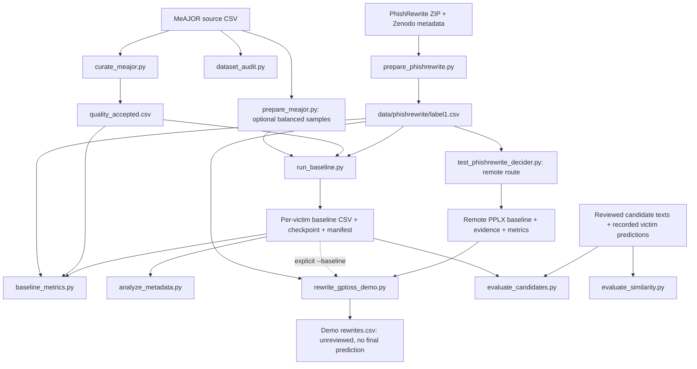

# PhishBench — phishing email classification and rewrite evaluation

PhishBench evaluates phishing email detection with **decision-model victims** and uses **gpt-oss-120b-abliterated** as the configured rewrite attacker. It supports original emails from **PhishRewrite** and **MeAJOR**, preserves source labels and text hashes, saves resumable model results, and analyzes reviewed rewrite candidates. The implemented generator produces disclosed training demonstrations; an automatic evasion loop is not implemented.

The SI-Lab launcher uses **http://127.0.0.1:11435 without an API key** for decision classification. Chat-victim code is retained as comments, and the Qwen/Gemma configuration entries are disabled. The original MeAJOR launchers also select only enabled decision victims.

## Contents

- [Scope and labels](#scope-and-labels)
- [Repository layout](#repository-layout)
- [Setup](#setup)
- [Quick start: PhishRewrite on SI-Lab](#quick-start-phishrewrite-on-si-lab)
- [How the scripts connect](#how-the-scripts-connect)
- [Dataset preparation](#dataset-preparation)
- [MeAJOR curation and classification](#meajor-curation-and-classification)
- [Models and connections](#models-and-connections)
- [GPT-OSS demonstration rewrites](#gpt-oss-demonstration-rewrites)
- [Reviewed candidate evaluation](#reviewed-candidate-evaluation)
- [Data contracts and output files](#data-contracts-and-output-files)
- [Metrics and interpretation](#metrics-and-interpretation)
- [Checkpoints and reproducibility](#checkpoints-and-reproducibility)
- [Script and module reference](#script-and-module-reference)
- [Validation and troubleshooting](#validation-and-troubleshooting)
- [Further documentation and sources](#further-documentation-and-sources)

## Scope and labels

The research design is: classify an original phishing email, select originals correctly detected as phishing, obtain a rewrite, and classify that rewrite with the same victim. A prediction change is meaningful only alongside evidence that the rewrite preserves the relevant phishing intent.

The repository currently implements these parts:

| Component | Current implementation |
| --- | --- |
| Dataset preparation | PhishRewrite originals; MeAJOR raw-data adapter and optional balanced sampling |
| Curation | MeAJOR English/body-length filtering, with a complete audit |
| Victim classification | Structured `systemone` decision calls only; chat-victim execution is commented out |
| Remote PPLX test | Verified Open WebUI tool results or an authenticated direct decision endpoint |
| GPT-OSS rewriting | `gpt-oss-120b-abliterated` generates explicit phishing-awareness demonstrations selected from decision-victim detections |
| Candidate analysis | Offline analysis of reviewed texts and predictions supplied by the operator |
| GAN attacker | Configuration metadata only; no executable GAN generation/training script |
| Automatic rewrite/reclassify loop | Not implemented; the demonstration script does not call the victim again |

`dataset_label=1` means the **original** email is labeled phishing; `0` means non-phishing. Victim predictions use the same numeric mapping:

- Original label 1, prediction 1: a true positive, eligible for the detected-original pool.
- Original label 1, prediction 0: an original-email false negative. No rewrite attack has occurred.
- Detected original, rewritten text predicted 0: a raw label flip. It is not automatically validated attack success.
- Missing, invalid, or failed responses: no valid classification; do not infer a prediction.

Source labels are never overwritten by model predictions. An original label does not independently establish the label or preserved intent of a rewritten text.

## Repository layout

```text
.
├── config/
│   ├── models.json                 # Victim IDs, model tags, default endpoints
│   └── datasets.json               # Dataset configuration and provenance
├── data/
│   ├── meajor_cleaned_preprocessed.csv
│   └── phishrewrite/               # Release archive, metadata, prepared originals
├── phishbench/                     # Shared Python modules
├── scripts/                        # Executable pipeline stages
├── templates/                      # Demo prompt and offline candidate schema
├── tests/                          # Offline regression tests
├── outputs/                        # Audits, manifests, checkpoints, predictions
├── docs/                           # Detailed workflow notes
├── RUN_*.bat / RUN_*.sh             # Original Windows / Unix launchers
├── RUN_*.ps1                       # SI-Lab, remote Decider, GPT-OSS launchers
├── requirements.txt
├── requirements-analysis.txt
├── VALIDATION_STATUS.md
└── CHANGELOG.md
```

Run commands from the repository root. Python modules under `phishbench/` are imported by the scripts; they are not separate pipeline commands.

## Setup

Use **Python 3.10 or newer**. In PowerShell:

```powershell
python -m venv .venv
$PipelinePython = '.venv/Scripts/python.exe'
& $PipelinePython -m pip install -r requirements.txt
```

The launchers automatically choose `.venv/Scripts/python.exe` when present, otherwise `python`. The examples below use `$PipelinePython` from this setup.

For Linux/macOS:

```bash
python3 -m venv .venv
.venv/bin/python -m pip install -r requirements.txt
```

Use the available `.sh` launchers or invoke the Python scripts directly. The newer `.ps1` launchers are PowerShell scripts; there is no matching shell launcher for every one.

Core HTTP inference uses the Python standard library. `requirements.txt` supplies language detection. Install optional similarity dependencies only when needed:

```powershell
& $PipelinePython -m pip install -r requirements-analysis.txt
```

### Check that dataset files contain actual data

In the checkout inspected for this README, the prepared PhishRewrite CSV and release archive are present. However, `data/meajor_cleaned_preprocessed.csv` and `templates/offline_candidates_template.csv` contain **Git LFS pointers**, not their actual CSV payloads.

```powershell
Get-Content data/meajor_cleaned_preprocessed.csv -TotalCount 3
Get-Content templates/offline_candidates_template.csv -TotalCount 3
```

A file beginning with `version https://git-lfs.github.com/spec/v1` must be replaced with its real payload before use. Retrieve it through Git LFS if the repository remote provides the object, or obtain the matching source dataset from its release. Preserve the expected filename/schema. A pointer file is not a usable dataset, even though its extension is `.csv`.

## Quick start: PhishRewrite on SI-Lab

This path classifies the released label-1 originals directly. It does **not** apply MeAJOR's English/length curation.

First inspect available model tags:

```powershell
& $PipelinePython scripts/check_ollama.py --base-url http://127.0.0.1:11435 --model pplx-decider:latest
```

Prepare a ten-row run plan without inference, then run it:

```powershell
.\RUN_BASELINE_SILAB.ps1 -DryRun
.\RUN_BASELINE_SILAB.ps1
```

Defaults are:

| Setting | Value |
| --- | --- |
| Input | `data/phishrewrite/label1.csv` |
| Gold-label selection | `1` |
| Victim | `pplx_decider` → `pplx-decider:latest` |
| Decision base URL | `http://127.0.0.1:11435` |
| Limit | First 10 selected rows |
| Checkpoint interval | Every row |
| Output directory | `outputs/phishrewrite_silab_test` |
| Authentication | None |

A dry run validates preparation and writes `run_plan.csv`; it does not test the server or generate predictions. A real run checks model availability, classifies the selected rows, then calculates metrics.

Other examples:

```powershell
# All 5,390 prepared positive originals; use a separate directory.
.\RUN_BASELINE_SILAB.ps1 -Limit 0 -OutputDirectory outputs/phishrewrite_silab_all

# All three enabled decision victims on the same selected input.
.\RUN_BASELINE_SILAB.ps1 -Victims pplx_decider,nimble_9b,tev1_4b -Limit 10 -OutputDirectory outputs/phishrewrite_silab_decisions
```

`-ChatModel` and baseline `--chat-model` are disabled. Explicitly selecting a chat victim is rejected, even if its configuration is re-enabled. `-Limit 0` means all selected rows, not zero rows. Positive limits take the first N rows; this is not random sampling.

The default ten-row output includes:

```text
outputs/phishrewrite_silab_test/
├── selected_input.csv
├── run_plan.csv
├── pplx_decider_baseline.csv
├── pplx_decider_baseline.csv.run.json
├── pplx_decider_baseline.csv.checkpoint.jsonl
└── metrics.csv
```

For full runs, `run_baseline.py` does not create `selected_input.csv`; metrics use the original input with the same label selection. Rerun the same command to resume.

## How the scripts connect

Arrows below show file/data dependencies. Optional analysis stages are invoked separately; creating a file does not automatically launch its consumers.



For limited baselines, use `selected_input.csv` as the dataset supplied to metrics and paired candidate evaluation. Those scripts require the dataset and baseline to describe the same cohort.

### SI-Lab call chain

```text
RUN_BASELINE_SILAB.ps1
  ├─ check_ollama.py                    (skipped for -DryRun)
  │    └─ phishbench.ollama_backend → GET /api/tags
  ├─ run_baseline.py
  │    ├─ phishbench.data              → load rows, labels, hashes, checkpoints
  │    ├─ phishbench.workflow          → validate curated inputs when required
  │    ├─ config/models.json           → resolve victim IDs and model tags
  │    ├─ phishbench.classification    → PHISHING/NON_PHISHING decision criteria
  │    └─ phishbench.ollama_backend
  │         └─ decision victim only   → POST /v1/systemone
  └─ baseline_metrics.py              (only after a successful real run)
       └─ phishbench.data             → verify matching cohort and text hashes
```

Decision requests send the original email as `state` with a structured `email_class` question, using the criteria in [classification.py](phishbench/classification.py). The old chat prompt remains only for existing manifest-hash compatibility; the chat classification implementation and dispatch are commented out. Curator prompts are separate: they ask about language, not phishing intent.

## Dataset preparation

### PhishRewrite

The adapter reads the original `data/emails.csv` inside the release ZIP, checks the archive against the published MD5 in the saved Zenodo record, and writes prepared rows plus SHA-256 provenance.

```powershell
& $PipelinePython scripts/prepare_phishrewrite.py --archive data/phishrewrite/phishrewrite-benchmark-v1.0.zip --record data/phishrewrite/zenodo_record.json --output data/phishrewrite/label1.csv
```

It reads local files; it does not download the archive or metadata. Obtain missing files from the [PhishRewrite release](https://zenodo.org/records/21018700).

The prepared release contains **5,390 original positive emails**, retaining **4,312 train / 1,078 test** memberships in `source_split`. It preserves released email text and defanged URLs verbatim, without language/length filtering or prediction-based selection. Published rewritten emails are not used by this adapter.

Outputs:

- `label1.csv`: prepared original emails.
- `label1.csv.source.json`: source/archive/output hashes, counts, and provenance.

The classification examples use both source splits for inference. Any later training must explicitly respect those splits; running inference does not create a new train/test partition.

### MeAJOR

The raw adapter expects `subject`, `body`, `label`, and `source`. It constructs classification text from subject and body, creates row IDs/text hashes, and preserves source metadata.

After obtaining the real CSV:

```powershell
.\RUN_AUDIT.bat
```

This calls `dataset_audit.py` and writes `outputs/meajor_dataset_audit.json`. The saved historical audit reports 108,685 rows: 60,650 label 0, 48,034 label 1, and one invalid label. These counts describe the previously audited payload, not a fresh audit of the pointer file.

Optional legacy balanced samples are available:

```powershell
.\RUN_PREPARE_PILOT.bat
.\RUN_PREPARE_MAIN.bat
```

They call `prepare_meajor.py` to request 500 or 1,500 examples per class, respectively, using language/length filtering, deduplication, and deterministic selection. They produce `data/meajor_pilot_1000.csv` and `data/meajor_main_3000.csv`. These are alternative sampled cohorts, not required steps in the all-label-1 curation workflow and not automatically disjoint train/test sets.

## MeAJOR curation and classification

The default MeAJOR path is:

```text
Raw CSV → all label-1 rows → body has at least 101 alphabetic words
        → PPLX checks English → quality_accepted.csv
        → victim baselines → metrics and metadata analysis
```

### 1. Curate

```powershell
.\RUN_CURATE_PPLX.bat
```

This runs `curate_meajor.py` with provider `ollama`, model `pplx-decider:latest`, base URL `http://127.0.0.1:11435`, policy `english_length`, and minimum 101 words.

Body length is measured on the full body, excluding the subject. Short rows are rejected locally. The model sees up to 20,000 body characters and judges whether the body is English. There is no sampling, automatic deduplication, phishing prediction gate, or model-confidence threshold in this policy. Curator acceptance does not independently validate the source's phishing label.

Results go to `outputs/quality_pplx_english_length_v3/`: `quality_audit.csv`, `quality_accepted.csv`, `quality_summary.json`, `quality_manifest.json`, and `quality_checkpoint.jsonl`. Final CSV exports and the summary are published after curation completes; checkpoints preserve intermediate progress.

Progress includes completed counts, checkpoint reuse, elapsed time and an ETA when enough timing samples exist. A pending model request can delay the next progress update. `english_score` is intentionally blank for this policy; model-choice confidence, when present, is separate from a language probability.

### 2. Validate the baseline plan

```powershell
.\RUN_BASELINE_DRY_RUN.bat
```

This calls `run_baseline.py --require-curated --dry-run`, checks the accepted input's curation annotations and text hashes, and writes the run plan. It performs no inference.

### 3. Run victim classification

```powershell
.\RUN_BASELINE.bat
```

The original launcher uses all enabled decision victims on port **11435**. To select the SI-Lab decision endpoint explicitly for the same curated cohort:

```powershell
$CuratedDataset = 'outputs/quality_pplx_english_length_v3/quality_accepted.csv'
$BaselineDirectory = 'outputs/curated_silab_baseline'
& $PipelinePython scripts/run_baseline.py --input $CuratedDataset --require-curated --label 1 --decision-base-url http://127.0.0.1:11435 --output-dir $BaselineDirectory
```

Supply `--victims pplx_decider` to select one configured decision victim. Otherwise the script uses all enabled decision victims. The old `--base-url` argument and chat-endpoint manifest field remain for decision-checkpoint compatibility; active inference uses `--decision-base-url` only.

### 4. Calculate metrics and metadata reports

The original baseline launcher does not automatically run the metrics stage:

```powershell
& $PipelinePython scripts/baseline_metrics.py --dataset $CuratedDataset --dir $BaselineDirectory --output "$BaselineDirectory/metrics.csv"

Get-ChildItem -LiteralPath $BaselineDirectory -Filter '*_baseline.csv' | ForEach-Object {
    $VictimId = $_.BaseName -replace '_baseline$', ''
    & $PipelinePython scripts/analyze_metadata.py --dataset $CuratedDataset --baseline $_.FullName --output "$BaselineDirectory/$($VictimId)_metadata.csv"
}
```

If using the original launcher, set `$BaselineDirectory = 'outputs/curated_english_length_baseline'`. Always use the same cohort for classification and reporting.

Metadata reports group by source, stored placeholder count, and stored word count. The PhishRewrite adapter does not populate the MeAJOR `placeholder_count`/`word_count` fields; the metadata script defaults missing values to zero. Do not interpret its PhishRewrite length/placeholder groups as measured characteristics.

### Optional curation paths

| Launcher or script | Purpose |
| --- | --- |
| `RUN_CURATE_PPLX_OPENWEBUI.ps1` | English/length curation through the Open WebUI PPLX tool; output `outputs/quality_pplx_openwebui_english_length_v3` |
| `RUN_CURATE_PPLX_API.ps1` | Authenticated direct Decider curation; output `outputs/quality_pplx_remote_english_length_v3` |
| `RUN_CURATE_JEV.bat` / `.sh` | Same English/length policy through OpenRouter; requires `OPENROUTER_API_KEY` |
| `RUN_CURATE_LANGDETECT.bat` / `.sh` | Separate language/readability diagnostic |
| `compare_curations.py` | Compare two audits with matching IDs and source hashes |
| `freeze_approved.py` | Export the intersection accepted by one or more audits; sample only if explicitly requested |

The Open WebUI curation launcher can import prior decisions under the historical operator declaration that both routes use the same backend. Use `-ResumeFrom ''` to disable that import when it does not apply. The Python option `--resume-prechecks-from` imports matching local length rejections without asserting model equivalence. Imported decisions retain their original provenance.

After choosing a different accepted/frozen CSV, pass that path explicitly to baseline `--input` and every analysis `--dataset`. Existing launchers do not automatically switch to a remote curation directory.

Historical `outputs/quality_pplx_label1` results used a different readability policy (31,056 accepted of 48,034). Their acceptance flags do not establish eligibility under the current English/101-word policy.

## Models and connections

### Configured victims

[config/models.json](config/models.json) contains:

| Victim ID | Model tag | Route kind | Enabled by default |
| --- | --- | --- | --- |
| `qwen35_9b` | `qwen3.5:9b` | Legacy chat, execution commented out | No; selection rejected |
| `gemma4_e4b` | `gemma4:e4b` | Legacy chat, execution commented out | No; selection rejected |
| `pplx_decider` | `pplx-decider:latest` | Decision | Yes |
| `nimble_9b` | `nimble:9b` | Decision | Yes |
| `tev1_4b` | `tev1:4b` | Decision | Yes |
| `clef_flash_9b` | `clef-flash:9b` | Decision | No |
| `clef_27b` | `clef:27b` | Decision | No |

Configuration is not proof that a model is installed or that an endpoint serves it. Check tags before inference. Explicit `--victims` can select the CLEF decision models, which remain disabled by default; it cannot select chat models. JSON does not support comments, so the legacy chat entries use `enabled: false` and explanatory notes.

The `attacker.tag` is `gpt-oss-120b-abliterated`, and `rewrite_gptoss_demo.py` reads it as its default model. Its provider is Open WebUI. The victim baseline does not launch this generator automatically. The `methods`, `gan`, and sampling entries remain experiment metadata; the OpenAttack/SST GAN entry is not evidence of an email-trained GAN.

### Transport choices

| Path | API | Credentials | Main entry point |
| --- | --- | --- | --- |
| Local SI-Lab decision | `http://127.0.0.1:11435/v1/systemone` | None | `RUN_BASELINE_SILAB.ps1` |
| Open WebUI PPLX tool | `https://llms.si-lab.org/api/chat/completions` | `OPENWEBUI_API_KEY` | `RUN_PHISHREWRITE_PPLX_TEST.ps1` |
| Authenticated direct Decider | Exact server-provided `.../systemone` URL | `PPLX_API_KEY` | Same test launcher with `-Transport direct` |
| GPT-OSS demo generation | Open WebUI chat completions, tools disabled | `OPENWEBUI_API_KEY` | `RUN_GPTOSS_DEMO_REWRITE.ps1` |

The local baseline client is restricted to local addresses by default; supplying an arbitrary remote URL is not a substitute for the authenticated remote adapters. Open WebUI and direct Decider credentials are distinct; an Open WebUI key does not imply direct backend access.

### Open WebUI and authenticated direct tests

```powershell
# Defaults to the existing Open WebUI PPLX tool; hidden key prompt if needed.
.\RUN_PHISHREWRITE_PPLX_TEST.ps1

# Requires an actual authenticated endpoint and its exact model ID.
.\RUN_PHISHREWRITE_PPLX_TEST.ps1 -Transport direct -EndpointUrl 'https://YOUR-SERVER/v1/systemone' -Model 'YOUR-DECIDER-MODEL' -OutputDirectory outputs/phishrewrite_pplx_direct_test
```

The Open WebUI adapter still uses `openai/gpt-oss-120b` to route requests to `server:pplxdeciderflash`. This is a tool router, not a victim or the rewrite attacker; PPLX supplies the decision. The adapter accepts only structured tool evidence with matching state/instructions/criteria, not the routing model's prose. It supports the observed flat `classify_with_pplx_decider` operation and structured `systemone` results. Remote `--chat-model` options refer to this router, not to victim selection.

Unicode substitutions by the routing model are rejected. The dedicated test enables Unicode-escaped request encoding, but this does not guarantee preservation. The local SI-Lab decision route sends the original state directly, avoiding that intermediary. Use a new output directory when changing transports.

The remote test saves `last_response.json` and failure diagnostics when available. API keys come from environment variables or hidden launcher prompts; do not put them in source or command-line arguments. `check_decider.py` tests a synthetic department-routing example, not email detection performance.

## GPT-OSS demonstration rewrites

The configured attacker is **`gpt-oss-120b-abliterated`**. The implemented generator creates clearly disclosed training examples, such as “Hello, I am a phishing message,” using placeholders. It selects originals that the supplied decision-victim baseline successfully classified as phishing.

```powershell
.\RUN_GPTOSS_DEMO_REWRITE.ps1
```

Defaults:

- Input: `data/phishrewrite/label1.csv`.
- Baseline: **`outputs/phishrewrite_pplx_test/pplx_decider_baseline.csv`**, the older Open WebUI run.
- Model: `gpt-oss-120b-abliterated`, read from `config/models.json` → `attacker.tag`, through Open WebUI with tools disabled.
- Prompt: [templates/gptoss_demo_rewrite_prompt.txt](templates/gptoss_demo_rewrite_prompt.txt).
- Limit: three detected originals; `-Limit 0` selects all available detected originals.
- Output: `outputs/phishrewrite_gptoss_demo/rewrites.csv`, plus checkpoints and a manifest.

The launcher does not expose a baseline parameter. To select the SI-Lab baseline instead, use the Python script:

```powershell
& $PipelinePython scripts/rewrite_gptoss_demo.py --input data/phishrewrite/label1.csv --baseline outputs/phishrewrite_silab_test/pplx_decider_baseline.csv --limit 3 --output-dir outputs/phishrewrite_gptoss_silab_demo --dry-run
```

After inspecting preparation, remove `--dry-run` to generate, with `OPENWEBUI_API_KEY` available in the environment. The Python entry point does not provide the launcher's hidden key prompt. `--config` selects another model configuration; `--model` can override the attacker with an exact server model ID. The configured abliterated ID must exist on your Open WebUI server; its live availability has not been verified by this change. Use a new output directory for the changed model rather than mixing previous GPT-OSS checkpoints.

A partial baseline is allowed, but included rows must identify `victim_kind=decision` and match original IDs, labels, and hashes. Chat-victim baselines are rejected. Original false negatives are excluded. The generator enforces its training-example format and address restrictions; generated content still needs review.

Output starts with `review_status=unreviewed`, empty `rewrite_label` and `final_prediction`, and `valid_for_evasion_asr=0`. These openly disclosed demonstrations remove deception. They must not be reported as intent-preserving phishing evasions. This script does not reclassify generated text or compute attack success.

## Reviewed candidate evaluation

These scripts consume **pre-existing candidate texts and recorded victim predictions**. They do not generate candidates or call a victim.

The candidate CSV requires:

```csv
row_id,method,candidate_text,review_status,final_prediction
```

Use `review_status=approved` only after actual review and `final_prediction=0` or `1` only from a completed classification. Keep the victim, source cohort, and prediction provenance consistent. Candidate IDs must match original rows; duplicate `(row_id, method)` pairs are rejected by candidate evaluation.

For a limited SI-Lab run, after supplying your own reviewed candidate CSV:

```powershell
& $PipelinePython scripts/evaluate_candidates.py --dataset outputs/phishrewrite_silab_test/selected_input.csv --baseline outputs/phishrewrite_silab_test/pplx_decider_baseline.csv --candidates data/reviewed_candidates.csv --output-dir outputs/phishrewrite_review

& $PipelinePython scripts/evaluate_similarity.py --dataset outputs/phishrewrite_silab_test/selected_input.csv --candidates data/reviewed_candidates.csv --output outputs/phishrewrite_review/similarity.csv
```

`data/reviewed_candidates.csv` is an operator-supplied file, not a bundled completed result. Add `--sbert` to similarity analysis to load `sentence-transformers/all-MiniLM-L6-v2`; the first run may download model weights.

Candidate evaluation scores only approved, nonempty candidates with valid final predictions for **original baseline true positives**. It writes `candidate_metrics.csv`, per-method `summary.csv`, and a paired McNemar report when exactly two methods are present.

Similarity analysis includes approved, nonempty candidates with known IDs, independently of baseline detection. Its population can therefore differ. It reports BLEU, ROUGE-L, Jaccard, retention, length ratio and optional SBERT cosine.

Interpretation limits:

- Lexical similarity or retained URLs do not prove preserved phishing intent.
- The URL retention regex recognizes ordinary HTTP(S)/www addresses, not all defanged forms such as `hxxps`.
- Despite its `SBERT_cosine_0_1` column name, the implementation does not clip cosine values; negative values are possible.
- Candidate evaluation does not enforce the demo's `valid_for_evasion_asr` field. Do not promote awareness demonstrations into an evasion cohort merely by changing review flags.

## Data contracts and output files

### Prepared originals

The shared prepared-dataset schema requires `row_id`, `dataset_label`, `original_text`, and `original_sha256`. Additional fields preserve corpus, split, source IDs, and dataset-specific metadata. `original_sha256` identifies the exact UTF-8 classification text.

Raw MeAJOR CSVs are adapted by `phishbench.data.read_dataset()`; prepared CSVs are read through the same entry point. IDs and hashes link the stages. Prediction and analysis files must refer to those same originals.

### Artifact producers and consumers

| Artifact | Produced by | Consumed by |
| --- | --- | --- |
| Prepared PhishRewrite CSV + `.source.json` | `prepare_phishrewrite.py` | Baseline, remote test, demo, reporting |
| Dataset audit JSON | `dataset_audit.py` | Operator inspection |
| `quality_audit.csv` | `curate_meajor.py` | Curation comparison and intersection |
| `quality_accepted.csv` | `curate_meajor.py` | Curated baseline and analysis |
| Frozen cohort + `.source.json` | `freeze_approved.py` | Explicitly selected baseline and analysis |
| `run_plan.csv` | `run_baseline.py` | Operator inspection; not completed results |
| `selected_input.csv` | Limited real baseline / dedicated remote test | Matching metrics and candidate evaluation |
| `<victim_id>_baseline.csv` | Baseline / remote test | Metrics, metadata, demo selection, candidate evaluation |
| `metrics.csv` | `baseline_metrics.py` | Performance reporting |
| `rewrites.csv` | `rewrite_gptoss_demo.py` | Demonstration review; no final predictions supplied |
| Reviewed candidates CSV | Operator/external review and classification | Candidate and similarity analysis |
| Candidate metrics / summary | `evaluate_candidates.py` | Paired offline reporting |
| Similarity CSV | `evaluate_similarity.py` | Text-comparison reporting |

Baseline rows include source identity/hash, gold label, victim/model identity, prediction, response status/error, and confidence/probabilities where supplied. Confidence is not necessarily a calibrated probability.

## Metrics and interpretation

`baseline_metrics.py` verifies matching dataset/baseline IDs and source text hashes. It scans `*_baseline.csv` in the selected directory, so keep different cohorts in separate directories.

For positive-only runs:

| Measure | Meaning |
| --- | --- |
| True positives (TP) | Valid phishing predictions on label-1 originals |
| False negatives (FN) | Valid non-phishing predictions on label-1 originals |
| Recall | `TP / (TP + FN)`: valid positive classifications only |
| Detection rate | `TP / all source positives`: includes unavailable classifications in the denominator |
| Coverage | Valid classifications divided by valid binary-labeled source rows |
| True-positive pool | Detected originals available for paired candidate evaluation |

Invalid labels and unsuccessful responses are accounted for separately; a transport failure is not a non-phishing prediction. Inspect these counts alongside recall. Baseline rate fields use fractions rather than percentages.

A label-1-only cohort cannot measure benign false-positive rate or representative two-class performance, even if accuracy/precision/F1 columns are present. Small sequential connection tests are not representative benchmarks.

Candidate summaries distinguish raw flips among reviewed/scored candidates from flips over the full original true-positive pool. Neither automatically establishes validated attack success. `phishbench.analysis` includes paired/bootstrap helpers, but the standard baseline metrics command does not automatically produce confidence intervals.

## Checkpoints and reproducibility

Long-running stages save per-row JSONL checkpoints and run manifests. Baseline manifests bind the source file, model identity, endpoints, task/prompt hashes and relevant selection settings. Curation and demo manifests bind their own policies/prompts and source dependencies.

- Resume with the same command and output directory after fixing a transient issue.
- Use a new directory when changing data, limit, model, endpoint, prompt, or curation policy.
- Preserve manifests, checkpoints, and imported-checkpoint snapshots together.
- Do not run concurrent writers against the same output directory.
- A CSV can be partial while baseline inference is running. Wait for completion before combined metrics.
- A saved nonresponse status may be reused on resume; resume does not automatically retry every recorded failure.
- Shared checkpoint loading can recover a torn final record; duplicate IDs and malformed complete records are errors.

Model tags and tool IDs record the requested identity, not an immutable digest of server weights. Save the server/model revision separately when reporting reproducible experiments.

## Script and module reference

### Executable Python scripts

Run any entry point with `--help` for its actual options.

| Script in `scripts/` | Inputs → outputs / role |
| --- | --- |
| `dataset_audit.py` | Raw MeAJOR → counts, labels, sources, placeholders audit |
| `prepare_meajor.py` | Raw MeAJOR → optional filtered, balanced sample |
| `prepare_phishrewrite.py` | Release ZIP + metadata → original positive CSV + provenance |
| `curate_meajor.py` | Source rows + policy/provider → audit, accepted cohort, checkpoint |
| `compare_curations.py` | Two matching audits → acceptance comparison |
| `freeze_approved.py` | Source + audit(s) → accepted intersection + provenance |
| `check_ollama.py` | Base URL + optional tags → availability check; no emails |
| `check_decider.py` | Remote transport settings → synthetic structured-response check |
| `run_baseline.py` | Input + victim configuration → per-victim predictions and run state |
| `test_phishrewrite_decider.py` | Prepared positives + remote transport → PPLX results, evidence, metrics |
| `rewrite_gptoss_demo.py` | Originals + detected-positive baseline + prompt → disclosed demo rewrites |
| `baseline_metrics.py` | Matching dataset + baseline directory → one metric row per victim |
| `analyze_metadata.py` | Matching dataset + one baseline → grouped metadata report |
| `evaluate_candidates.py` | Dataset + baseline + reviewed predictions → paired candidate statistics |
| `evaluate_similarity.py` | Dataset + approved texts → lexical/optional embedding similarity |

### Shared Python modules

| Module in `phishbench/` | Responsibility and callers |
| --- | --- |
| `data.py` | Dataset adaptation, IDs/hashes, CSV/JSON writes and checkpoint handling; shared across stages |
| `workflow.py` | Default curated path and accepted-cohort validation; baseline and analysis defaults |
| `classification.py` | Decision criteria and legacy prompt-hash compatibility; baseline and dedicated test |
| `ollama_backend.py` | Local model discovery and decision classification; old chat-victim method commented out; low-level generation helper retained |
| `decision_api.py` | Structured decision parsing, authenticated requests and retry helpers; decision/curation transports |
| `openwebui_decider.py` | PPLX tool routing and strict evidence/argument validation; Open WebUI checks, curation and test |
| `quality.py` | Tokenization and candidate retention/length screens; offline evaluation |
| `analysis.py` | Statistical helpers, including exact McNemar and bootstrap utilities |

The presence of a low-level rewrite method in the backend does not connect an attacker to `run_baseline.py`; the baseline calls `classify_decision()` only. Chat-victim code is preserved as comments in the backend, Python baseline, and SI-Lab launcher.

### Launcher families

| Launcher | Main Python target |
| --- | --- |
| `RUN_AUDIT.bat` / `.sh` | `dataset_audit.py` |
| `RUN_PREPARE_PILOT.bat` / `.sh`, `RUN_PREPARE_MAIN.bat` / `.sh` | `prepare_meajor.py` |
| `RUN_CURATE_PPLX.bat` / `.sh`, `RUN_CURATE_JEV.bat` / `.sh`, `RUN_CURATE_LANGDETECT.bat` / `.sh` | `curate_meajor.py` |
| `RUN_BASELINE_DRY_RUN.bat` / `.sh`, `RUN_BASELINE.bat` / `.sh` | `run_baseline.py` |
| `RUN_BASELINE_SILAB.ps1` | `check_ollama.py` → `run_baseline.py` → `baseline_metrics.py` |
| `RUN_PHISHREWRITE_PPLX_TEST.ps1` | `test_phishrewrite_decider.py` |
| `RUN_CURATE_PPLX_OPENWEBUI.ps1`, `RUN_CURATE_PPLX_API.ps1` | `check_decider.py` → `curate_meajor.py` |
| `RUN_GPTOSS_DEMO_REWRITE.ps1` | `rewrite_gptoss_demo.py` |

## Validation and troubleshooting

Run offline regression tests from the repository root:

```powershell
& $PipelinePython -m unittest discover -s tests -v
```

Offline tests validate request construction, evidence checks, parsing, input/provenance guards, and resume behavior. They do not establish a live server's availability or benchmark performance.

Saved SI-Lab connection tests from **2 November 2026** recorded:

| Output directory | Model | Completed | PHISHING | NON_PHISHING |
| --- | --- | --- | --- | --- |
| `outputs/phishrewrite_silab_test` | `pplx-decider:latest` | 10/10 | 8 | 2 |
| `outputs/phishrewrite_silab_qwen_test` | `qwen3.5:9b` | 3/3 | 2 | 1 |

These are historical connection checks, not fresh results produced by reading this README. The Qwen result predates the decision-only configuration and remains archived; Qwen is no longer an active victim. The earlier Open WebUI test saved 8/10 results before a Unicode argument mismatch; its incomplete files remain separate. See the detailed workflow notes for context.

| Symptom | Check / resolution |
| --- | --- |
| CSV schema error on MeAJOR or the candidate template | Inspect the first lines for a Git LFS pointer; obtain the actual payload |
| Connection refused | Keep the SI-Lab service/tunnel on 11435 active; select the decision endpoint with `--decision-base-url` |
| Chat-victim selection rejected | Expected: use `pplx_decider`, `nimble_9b`, `tev1_4b`, or a configured CLEF decision model |
| Attacker model not found | Confirm the exact `gpt-oss-120b-abliterated` server ID; update `attacker.tag` or pass generator `--model` |
| Missing model tag | Run `check_ollama.py`; use the exact available tag and compatible route |
| Local SI-Lab run asks for a key | Use `RUN_BASELINE_SILAB.ps1`; the remote test launcher intentionally requires authentication |
| `PPLX tool arguments differ ... (state)` | Routing changed the input. No decision is saved. Use the direct local route for unchanged text; keep old checkpoints separate |
| Missing curated dataset | Finish curation first, or explicitly supply the prepared PhishRewrite input for its separate workflow |
| Manifest mismatch | Restore the original settings to resume, or select a new output directory |
| Metrics report mismatched IDs/counts | Wait for a complete run and use the same cohort; for limited runs use `selected_input.csv` |
| Demo selects unexpected originals | Check `--baseline`; its default points to the older Open WebUI results |
| Demo has no final prediction | Expected: generation does not call the victim |
| Similarity dependency error | Install `requirements-analysis.txt`; SBERT may also need an initial model download |
| High recall but low coverage | Inspect unsuccessful/invalid responses and detection rate before interpreting recall |
| No GAN run command | GAN execution is not implemented; configuration alone does not provide a runner |

## Further documentation and sources

- [SI-Lab classification](docs/silab_classification.md): local port 11435, model selection, full runs and resume.
- [PhishRewrite Decider test](docs/phishrewrite_test.md): remote transport details and historical Unicode failure.
- [GPT-OSS demonstration rewrites](docs/gptoss_demo_rewrite.md): prompt/output contract and scope.
- [Research protocol](docs/RESEARCH_PROTOCOL.md): research design and historical protocol context.
- [Validation status](VALIDATION_STATUS.md) and [changelog](CHANGELOG.md): recorded verification and changes.
- [PhishRewrite repository](https://github.com/gaurangkatyal/phishrewrite) and [release](https://zenodo.org/records/21018700).
- [MeAJOR release](https://zenodo.org/records/18471483) and [dataset paper](https://doi.org/10.1016/j.dib.2026.112595).

Consult the upstream dataset documentation and licenses before redistribution. Older notes may describe earlier defaults or server availability; executable entry points and explicitly selected input/output paths determine what a run actually does.
